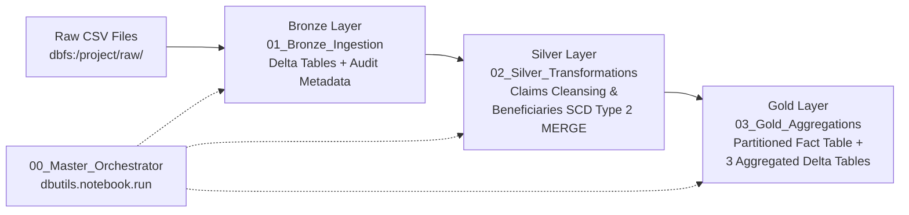

# Healthcare Claims Lakehouse Pipeline (Medallion Architecture & SCD Type 2)

An end-to-end Healthcare Claims Data Engineering pipeline built in **Databricks** using **PySpark**, **Delta Lake**, and **Spark SQL**. The project implements a 3-layer **Medallion Architecture (Bronze, Silver, Gold)** on DBFS, covering raw ingestion with audit metadata, transactional data cleansing, idempotent **Slowly Changing Dimension (SCD Type 2)** history tracking, optimized Gold-layer fact and aggregation tables, and modular notebook orchestration.

---

## Architecture Overview



---

## Tech Stack

* **Platform & Storage:** Databricks (Community Edition), DBFS, Delta Lake
* **Processing & Languages:** PySpark, Python, Spark SQL
* **Orchestration:** Databricks Utilities (`dbutils.notebook.run()`)
* **Data Modeling:** Medallion Architecture (Bronze / Silver / Gold), Slowly Changing Dimensions (SCD Type 2)

---

## Dataset Overview

The pipeline processes five relational healthcare CSV datasets stored in `dbfs:/project/raw/`:

| Dataset | Role | Rows | Key Columns |
| :--- | :--- | :---: | :--- |
| `claims.csv` | Transactional Fact | 2,000 | `claim_id`, `beneficiary_id`, `provider_id`, `claim_type`, `service_date`, `billed_amount`, `paid_amount`, `claim_status` |
| `beneficiaries.csv` | SCD Type 2 Dimension | 500 | `beneficiary_id`, `birth_date`, `gender`, `city`, `state`, `postal_code`, `region` |
| `providers.csv` | Lookup Dimension | 40 | `provider_id`, `provider_name`, `provider_type`, `specialty`, `city`, `state`, `region` |
| `diagnosis_codes.csv` | Clinical Lookup | 10 | `diagnosis_code`, `diagnosis_description`, `diagnosis_category` |
| `procedure_codes.csv` | Clinical Lookup | 10 | `procedure_code`, `procedure_description`, `procedure_category` |

---

## Pipeline Layers & Implementation

### 1. Bronze Layer (`01_Bronze_Ingestion`)
* Ingests all five raw CSV files from `dbfs:/project/raw/` with headers and inferred schemas.
* Appends audit metadata columns: `bronze_ingestion_timestamp` (`current_timestamp()`) and `bronze_source_file` (`input_file_name()`).
* Writes raw datasets as Delta tables under `dbfs:/project/bronze/`.

### 2. Silver Layer (`02_Silver_Transformations`)
* **Claims Cleansing:** Casts date columns (`service_date`, `admission_date`, `discharge_date`, `payment_date`) to `DateType`, casts `paid_amount` to `DoubleType`, and standardizes nulls (`rejection_reason` → `"Not Rejected"`, `paid_amount` → `0.0`, `claim_status` → `"Unknown"`).
* **Lookup Standardization:** Deduplicates and writes reference tables (`providers`, `diagnosis_codes`, `procedure_codes`) to `dbfs:/project/silver/`.
* **Beneficiaries SCD Type 2 (`MERGE INTO`):** Tracks historical changes in `city` and `postal_code` using `is_active`, `effective_start_date`, and `effective_end_date`. When a beneficiary moves, the existing active record is expired (`is_active = false`, `effective_end_date = current_date()`) and a new active record is inserted.

### 3. Gold Layer (`03_Gold_Aggregations`)
* **Enriched Fact Table (`claims_enriched`):** Joins cleansed claims with **active** beneficiaries (`is_active == True`) and broadcasts small lookup dimensions (`providers`, `diagnosis_codes`, `procedure_codes`). Derives business KPIs (`unpaid_amount`, `length_of_stay_days`, `payment_turnaround_days`) and writes to Delta **partitioned by `claim_type`**.
* **Analytics-Ready Delta Tables:**
  * `monthly_provider_billing` — Monthly claim volume, total billed vs. paid amounts, claim approval rate percentage, and average payment turnaround days per provider.
  * `diagnosis_cost_summary` — Claim counts, unique patients, total/average billed amounts, and average inpatient length of stay by diagnosis category and claim type.
  * `beneficiary_claim_summary` — Claim frequency, rejected claim counts, and total billed, paid, and unpaid amounts per beneficiary.

### 4. Orchestration (`00_Master_Orchestrator`)
* Triggers `01_Bronze_Ingestion`, `02_Silver_Transformations`, and `03_Gold_Aggregations` sequentially using `dbutils.notebook.run()`.
* Tracks stage-level execution time and re-raises exceptions on failure so downstream stages halt immediately.

---

## Key Engineering Highlights

* **Idempotent SCD Type 2 `MERGE`:** Expires and inserts records only when tracked attributes (`city` or `postal_code`) change, preventing duplicate active rows on re-runs.
* **Join Fan-Out Prevention:** Filters `beneficiaries` on `is_active == True` before joining with `claims`, preserving exact row cardinality (2,000 claims) and accurate financial totals.
* **Join & Storage Optimization:** Uses `F.broadcast()` on small lookup tables (10–40 rows) to avoid shuffle joins and partitions the Gold fact table by low-cardinality `claim_type` (`INPATIENT`, `OUTPATIENT`, `PHYSICIAN`).

---

## Repository Structure

```text
healthcare-claims-lakehouse/
├── README.md
└── notebooks/
    ├── 00_Master_Orchestrator.ipynb
    ├── 01_Bronze_Ingestion.ipynb
    ├── 02_Silver_Transformations.ipynb
    └── 03_Gold_Aggregations.ipynb
```

---

## How to Run in Databricks

1. Upload the five raw CSV files to DBFS under `dbfs:/project/raw/`.
2. Import the four notebooks from `notebooks/` into a single Databricks workspace folder (e.g., `Healthcare_Project`).
3. Attach your compute cluster and run `00_Master_Orchestrator`.
4. Inspect the resulting Delta tables in `dbfs:/project/bronze/`, `dbfs:/project/silver/`, and `dbfs:/project/gold/`.

---

## Future Enhancements

* Implement watermark-based incremental ingestion with landing/archive folder management for high-volume batch loads (50k–1M+ rows).
* Add automated data quality checks (row-count reconciliation and null validations) between Medallion stages.
